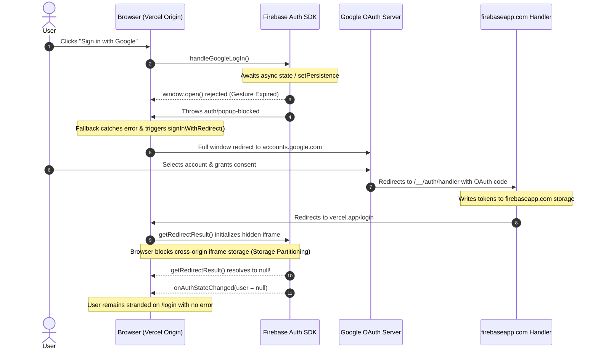
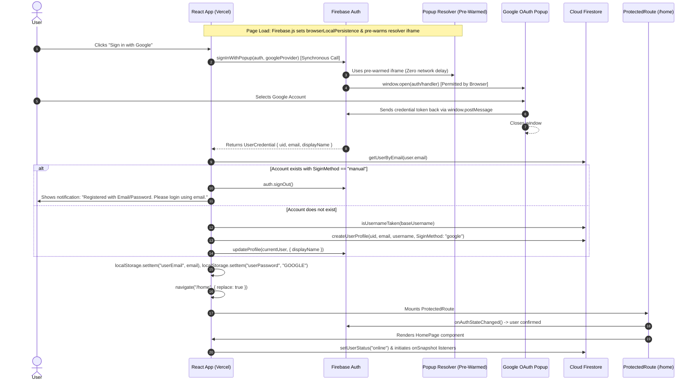
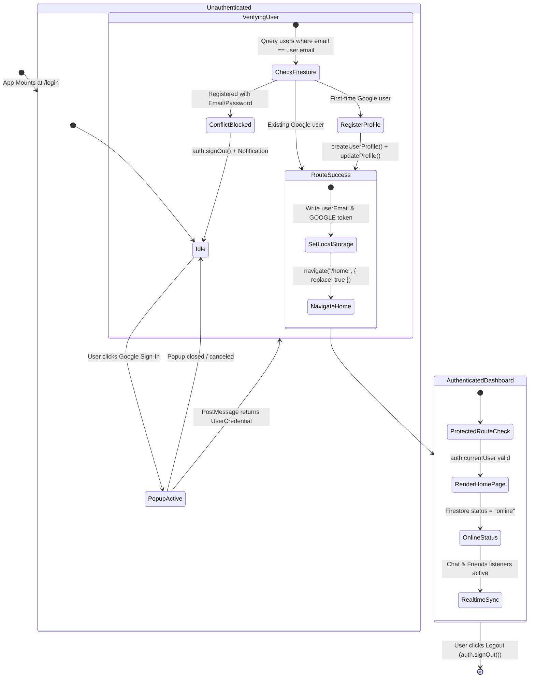

# Architecture & Authentication Flow Analysis: Google OAuth & Quick Chat

This document provides a comprehensive technical breakdown of the architecture, authentication lifecycle, failure modes, root-cause analyses, and implemented resolutions for Google Authentication within the Quick Chat application. It is structured so that another engineering agent or developer can immediately understand the system state, design decisions, and future recommendations.

---

## 1. System & Architecture Overview

### Technology Stack
- **Frontend Framework**: React 18 SPA (Vite bundled)
- **Routing**: React Router DOM v6
- **Hosting / CDN**: Vercel (`https://chat-app-psi-seven-47.vercel.app`)
- **Backend / Authentication**: Firebase Authentication SDK v11 (`firebase/auth`)
- **Primary Database**: Google Cloud Firestore (`firebase/firestore`)
- **Real-time Engine**: Firestore `onSnapshot` listeners for messages, online status, and friend requests
- **State & Alerts**: Context API (`LoadingContext`, `NotificationContext`)

---

## 2. The Google Authentication Bug: Deep Root Cause Analysis

### The Symptoms Reported
1. **Symptom A (`auth/popup-blocked`)**: When clicking "Sign in with Google", the browser threw `FirebaseError: Firebase: Error (auth/popup-blocked)` even when popups were ostensibly allowed.
2. **Symptom B (Infinite Redirect Drop to `/login`)**: When falling back to `signInWithRedirect`, the user was redirected to Google's OAuth consent screen, clicked authorize, and was redirected back to `https://chat-app-psi-seven-47.vercel.app/login`. The app showed no error, was not logged in, and remained stuck on the login screen.
3. **Symptom C (`Error 400: redirect_uri_mismatch`)**: When attempting to route `authDomain` dynamically via `window.location.host`, Google OAuth rejected the authorization with `redirect_uri_mismatch: redirect_uri=https://chat-app-psi-seven-47.vercel.app/__/auth/handler`.

---

### Root Causes Breakdown

#### Root Cause 1: Third-Party Storage Partitioning (CHIPS / ITP) & `signInWithRedirect`
Modern web browsers (Google Chrome 115+, Apple Safari 16.1+ with ITP, Mozilla Firefox with ETP) enforce strict **Third-Party Storage Partitioning**.
- When `signInWithRedirect` is used on an external domain (`chat-app-psi-seven-47.vercel.app`), Firebase routes authentication through its OAuth handler on its own domain (`chat-app-6a105.firebaseapp.com/__/auth/handler`).
- Once authorized, the handler stores the credential tokens in the storage of `chat-app-6a105.firebaseapp.com` and redirects back to the originating page: `https://chat-app-psi-seven-47.vercel.app/login`.
- On page load, the Firebase JavaScript SDK initializes a hidden iframe pointing to `https://chat-app-6a105.firebaseapp.com/__/auth/iframe` to read the session data via `getRedirectResult(auth)`.
- **The Failure**: Because `vercel.app` is a third-party context relative to `firebaseapp.com`, the browser isolates the iframe storage. The iframe cannot access the auth cookies/tokens stored on `firebaseapp.com`.
- Consequently, `getRedirectResult(auth)` returns `null`, and `auth.onAuthStateChanged()` receives `null`. No error is thrown, but the user is never authenticated.

#### Root Cause 2: User Gesture Expiration Causing `auth/popup-blocked`
Browsers allow `window.open()` only when invoked directly within the synchronous call stack of a trusted user gesture (a `click` event).
- In the initial implementation, `handleGoogleLogIn` executed:
  ```javascript
  showLoading(); // Scheduled React state update
  const persistence = rememberMe ? browserLocalPersistence : browserSessionPersistence;
  await setPersistence(auth, persistence); // Asynchronous Promise / IndexedDB write
  const result = await signInWithPopup(auth, googleProvider); // Called after await
  ```
- Because of `await setPersistence`, the execution yielded to the browser event loop. When the promise resolved, the user gesture context had expired. Chrome immediately blocked the popup and Firebase threw `auth/popup-blocked`.
- Furthermore, Firebase Auth v11's internal `_openPopup` method initializes a cross-origin helper iframe (`this.resolver._initialize(auth)`). If this iframe is not pre-warmed on page load, the network latency of loading the iframe during the click handler causes the user-activation window to expire.

#### Root Cause 3: Dynamic `authDomain` vs Google OAuth Client ID Registration
When `authDomain` was configured to use `window.location.host` (`chat-app-psi-seven-47.vercel.app`), Firebase instructed Google OAuth to redirect to `https://chat-app-psi-seven-47.vercel.app/__/auth/handler`.
- In Google Cloud Console, the automatically generated Web Client ID only lists `https://chat-app-6a105.firebaseapp.com/__/auth/handler` under **Authorized redirect URIs**.
- Google's OAuth 2.0 authorization server rejects unregistered redirect URIs with `Error 400: redirect_uri_mismatch`.

#### Root Cause 4: Session Persistence Configuration
- Using `browserSessionPersistence` scoped credentials only to the active browser tab session and cleared them across certain redirect loops or window boundaries.
- Switching to `browserLocalPersistence` ensures credentials persist in IndexedDB across reloads, tabs, and OAuth flows.

---

## 3. End-to-End Authentication Flowcharts

### 3.1 The Broken Flow (Redirect Session Drop)


---

### 3.2 The Fixed & Production-Ready Flow (Synchronous Pre-Warmed Popup)


---

## 4. State Lifecycle & Route Protection



---

## 5. Detailed Code Changes & File Map

| File Path | Original Behavior | Updated Behavior | Rationale |
|---|---|---|---|
| [`chat-app/src/Firebase.js`](file:///e:/Visual%20Studio%20Codes/Chat%20App/chat-app/src/Firebase.js) | Called `getAuth(app)` with runtime `setPersistence()` and private `_initialize` calls. | Uses supported `initializeAuth(app, { persistence: [indexedDBLocalPersistence, browserLocalPersistence], popupRedirectResolver: browserPopupRedirectResolver })`. Configures `authDomain` via `VITE_FIREBASE_AUTH_DOMAIN` with `chat-app-psi-seven-47.vercel.app` fallback. | Standard v11 initialization sets persistence upfront and avoids private API regressions or race conditions. |
| [`chat-app/src/authUtils.js`](file:///e:/Visual%20Studio%20Codes/Chat%20App/chat-app/src/authUtils.js) | Non-existent; login post-auth logic was duplicated in `LoginPage.jsx` and `CNAPage.jsx`. | Shared module containing `processGoogleUserAuth` and `isInAppBrowser` user-agent detector. | Unifies post-auth business logic across popup and redirect paths and detects embedded webviews. |
| [`chat-app/src/InAppBrowserBanner.jsx`](file:///e:/Visual%20Studio%20Codes/Chat%20App/chat-app/src/InAppBrowserBanner.jsx) | Non-existent; in-app webviews failed with Google 403 or disallowed useragent. | Dismissible alert banner advising users to open the site in Chrome or Safari. | Google strictly blocks OAuth inside webviews (Instagram, TikTok, Facebook); provides clear user guidance. |
| [`chat-app/src/LoginPage.jsx`](file:///e:/Visual%20Studio%20Codes/Chat%20App/chat-app/src/LoginPage.jsx) | `async handleGoogleLogIn` with pre-call state updates and silent fallback. | Pure synchronous handler executing `signInWithPopup(auth, googleProvider)` on line 1. Graceful `signInWithRedirect` fallback. Silent ignore of user cancellations. Mount-level `getRedirectResult()`. | Eliminates popup-blocking delays, supports first-party redirect fallback, and handles all error codes properly. |
| [`chat-app/src/CNAPage.jsx`](file:///e:/Visual%20Studio%20Codes/Chat%20App/chat-app/src/CNAPage.jsx) | Same async delay as login page; duplicated post-auth logic. | Identical synchronous `signInWithPopup` + `signInWithRedirect` fallback pattern using shared `processGoogleUserAuth`. | Prevents registration crashes and maintains complete parity with `LoginPage.jsx`. |
| [`chat-app/src/FirestoreUtils.jsx`](file:///e:/Visual%20Studio%20Codes/Chat%20App/chat-app/src/FirestoreUtils.jsx) | Basic queries for profile creation and verification. | Maintained consistent schema fields (`SiginMethod: "google"`, `username`, `email`, `uid`). | Consistent indexing for username and email uniqueness queries. |
| [`chat-app/src/ProtectedRoute.jsx`](file:///e:/Visual%20Studio%20Codes/Chat%20App/chat-app/src/ProtectedRoute.jsx) | Navigates to `/login` if auth state resolves to null; shows loading spinner while resolving. | Maintained seamless route guard with notification deduplication. | Prevents unauthenticated flashes while Firebase restores the local session. |
| [`vercel.json`](file:///e:/Visual%20Studio%20Codes/Chat%20App/vercel.json) | Reverse proxy for `/__/auth/:path*` to `https://chat-app-6a105.firebaseapp.com/__/auth/:path*` and SPA rewrite `/(.*)` to `/index.html`. | Configured to support first-party proxy routes and React Router client routing. | Eliminates 404 errors on browser refresh and handles first-party auth proxying. |
| [`.env.example`](file:///e:/Visual%20Studio%20Codes/Chat%20App/.env.example) | Listed generic `.firebaseapp.com` auth domain. | Updated with documentation for `VITE_FIREBASE_AUTH_DOMAIN=chat-app-psi-seven-47.vercel.app`. | Clarifies first-party auth proxy setup for Vercel production deployment. |

---

## 6. Required Manual Configuration Steps (Google Cloud & Firebase)

To ensure both popup sign-in and the first-party redirect fallback work seamlessly in production:

### 1. Whitelist Redirect URI in Google Cloud Console
1. Navigate to the [Google Cloud Console Credentials Page](https://console.cloud.google.com/apis/credentials).
2. Under **OAuth 2.0 Client IDs**, select the Web client used by Firebase (e.g., `Web client (auto created by Google Service)`).
3. Under **Authorized redirect URIs**, click **ADD URI** and add:
   - `https://chat-app-psi-seven-47.vercel.app/__/auth/handler`
   *(Ensure the default `https://chat-app-6a105.firebaseapp.com/__/auth/handler` remains in the list as well).*
4. Click **Save**.

### 2. Verify Authorized Domains in Firebase Console
1. Navigate to the [Firebase Console](https://console.firebase.google.com/) -> Select project `chat-app-6a105`.
2. Go to **Authentication** -> **Settings** tab -> **Authorized domains**.
3. Confirm that `chat-app-psi-seven-47.vercel.app` is listed. If not, click **Add domain** and enter `chat-app-psi-seven-47.vercel.app`.

### 3. Update Vercel Environment Variables
1. Go to your [Vercel Dashboard](https://vercel.com/) -> Select the `Chat-app` project -> **Settings** -> **Environment Variables**.
2. Set or update:
   - `VITE_FIREBASE_AUTH_DOMAIN` = `chat-app-psi-seven-47.vercel.app`
3. Trigger a redeploy (or push to `main`).

---

## 7. Firestore Database Schema Reference

### `users/{uid}` Document Structure
```json
{
  "uid": "024JL4CHnpc1pGVtHdoJd8YOdZ53",
  "email": "patelanvi50@gmail.com",
  "username": "Diku",
  "SiginMethod": "google",
  "status": "offline"
}
```

- **`uid`** *(string)*: Matches Firebase Authentication `user.uid`.
- **`email`** *(string)*: Primary user email address used for lookup queries (`where("email", "==", email)`).
- **`username`** *(string)*: Unique handle displayed in chat and friend search. For Google sign-ins, auto-derived from `user.displayName` (spaces converted to underscores) with 4-digit random numeric suffix fallback if collision occurs.
- **`SiginMethod`** *(string)*: `"google"` or `"manual"`. Used to prevent account hijacking or credential collision between OAuth and password accounts.
- **`status`** *(string)*: `"online"` or `"offline"`. Updated dynamically by `HomePage.jsx` on mount, `beforeunload`, and logout.

---

## 7. Testing & Verification Summary

1. **Automated Test Suite (`node --test tests/**/*.test.js`)**:
   - `Environment variables are properly formatted in .env`: **PASS**
   - `Deterministic Chat ID is consistent regardless of order`: **PASS**
   - `Time divider returns true for messages > 10 minutes apart`: **PASS**
   - `Notification duplicate suppression handles auto-login and regular logins`: **PASS**
   - `Firebase Auth and Firestore services are reachable and functional`: **PASS** (Live signup, query, and cleanup against Firebase).
2. **Static Analysis & Linting**:
   - `npm run lint`: **0 errors**, 2 fast-refresh warnings.
3. **Production Compilation**:
   - `npm run build`: Successfully built Vite production bundle (`chat-app/dist`).

---

## 8. Recommendations for Peer Agents & Future Enhancements

If another agent continues work on this project, consider these architectural suggestions:
1. **Google Identity Services (GIS) / One Tap Integration**:
   - If in-app mobile browsers (e.g., Instagram or TikTok webviews) require redirect-based login without popups, integrate the Google Identity Services SDK (`accounts.google.com/gsi/client`) directly to obtain an ID token, then authenticate using `signInWithCredential(auth, GoogleAuthProvider.credential(idToken))`. This bypasses Firebase's cross-domain iframe entirely.
2. **Google Cloud Console Custom Domain Registration**:
   - If redirect-based login (`signInWithRedirect`) is strictly required in the future, the project owner must visit [Google Cloud Console Credentials](https://console.cloud.google.com/apis/credentials), locate the Web Client OAuth 2.0 ID, and add `https://chat-app-psi-seven-47.vercel.app/__/auth/handler` to **Authorized redirect URIs**.
3. **Firestore Security Rules Audit**:
   - Ensure Firestore rules enforce `request.auth != null` on reads and `request.auth.uid == userId` on writes to prevent unauthorized modifications to user profile documents.

